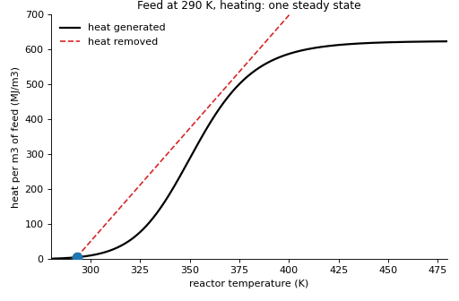
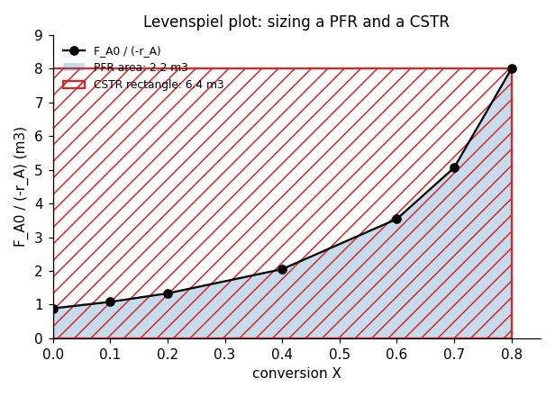
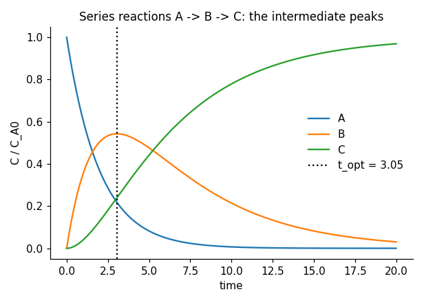
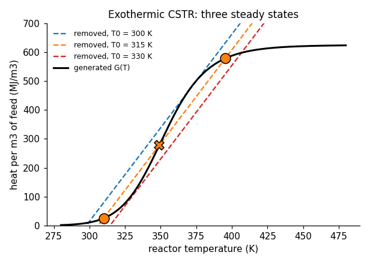
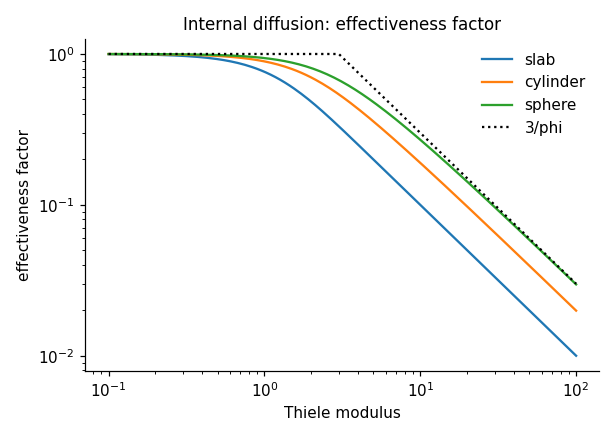
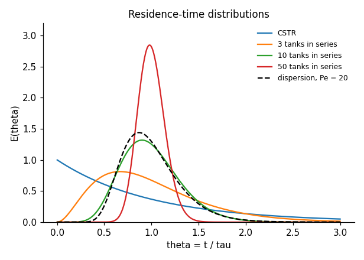
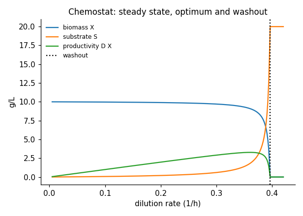

<div align="center">

# engreact

**Chemical reaction engineering - readable, validated Python, with an 18-notebook course.**

[](https://github.com/ktwyw/engreact/actions/workflows/tests.yml)
[](docs/VALIDATION.md)
[](notebooks)
[](pyproject.toml)
[](LICENSE)
[](https://orcid.org/0000-0002-8488-9833)



</div>

`engreact` covers an undergraduate course in chemical reaction engineering at the level of Fogler's *Elements
of Chemical Reaction Engineering* and Levenspiel's *Chemical Reaction Engineering*: rate laws and the analysis
of rate data, the ideal reactors and their sizing, multiple reactions and selectivity, energy balances with
multiple steady states and runaway, heterogeneous catalysis with internal and external transport, catalyst
deactivation, residence-time distributions and nonideal flow, bioreactors, and gas-solid reactions - with
applications from petrochemicals and catalytic converters to fermentation and reactor safety. Every method
is checked against analytic solutions, independent numerical integration and published values, and a course
of executed notebooks with worked solutions teaches the ideas.

```python
from engreact import energy, ideal, kinetics, rtd

k = kinetics.arrhenius(k0=5e7, Ea=68e3, T=320.0)                          # 1/s
ideal.pfr_conversion_first_order(k, tau=1800.0)                            # 0.51 after 30 min in a PFR
energy.cstr_steady_states(k0=5e7, Ea=68e3, dH=-250e3, C_A0=2500.0, T0=315.0, tau=240.0, cp_vol=3.6e6,
                          UA_over_v0cp=0.8, T_a=295.0)["T"]                # three steady states: 310, 349, 395 K
rtd.tanks_in_series_conversion(k=0.05, tau=40.0, n=4)                      # first-order conversion in a real vessel
```

## Why engreact?

- **Validated, not just tested.** 155 checks in [`docs/VALIDATION.md`](docs/VALIDATION.md), rerun in CI: every
  reactor formula against its analytic limit; Bateman's series solution against the numerical network; the
  three effectiveness-factor closed forms against the pellet boundary-value problem; the closed-vessel
  dispersion model, solved numerically, against Levenspiel's variance formula to 0.1 %; the CSTR's three steady
  states and their stability against transient integration; heats of reaction and heat capacities against
  NIST; adiabatic flame temperatures against Turns; Danckwerts's dispersion conversion at both limits; the
  recycle reactor at both limits; segregation and maximum mixedness for first and second order.
- **Self-contained.** Its own thermochemistry (25 species with heats of formation and Cp polynomials), so
  equilibrium constants, heats of reaction and adiabatic temperatures need nothing outside NumPy and SciPy.
- **Robust numerics where the textbooks stop.** Stiff-capable integrators throughout; Danckwerts's formula
  written to survive any Peclet number; a deactivation trajectory with an explicit temperature and a maximum-
  temperature stop; steady-state CSTRs found by settling and polishing rather than by hoping Newton converges.
- **Course data with stated faults.** Pseudo-experimental files generated from the library's own models, with
  the noise and the deliberate faults (a mis-read sample, a temperature in the wrong unit, a run that ran away)
  documented in each header - and a pilot-plant project that ends in a design and a safety window.

## What's inside

| Module | Methods |
|---|---|
| `thermo` | species table (25 species), heats of reaction at any T, equilibrium constants with full Cp integration, Kc from Kp, adiabatic temperature by energy balance |
| `kinetics` | Arrhenius and its fitting, power-law and reversible rate laws, `Reaction` and stoichiometric tables (liquid; gas with epsilon, P and T), equilibrium conversion |
| `rate_data` | differential, integral, half-life and initial-rate methods; nonlinear regression with standard errors; model comparison by AIC |
| `ideal` | batch, CSTR, PFR, PBR: analytic cases and general design equations; Levenspiel plots; reactors in series; recycle; numerical multi-species reactors; Ergun pressure drop and packed beds |
| `multiple` | Bateman series solutions and optimum times, selectivity and yield, a `Network` class for any reaction scheme in batch, PFR, CSTR and semibatch |
| `energy` | adiabatic and heat-exchange PFR, CSTR heat-generation/removal curves, multiple steady states and stability, ignition-extinction diagrams, unsteady CSTR, batch with heat exchange, Semenov's criterion |
| `catalysis` | Langmuir isotherms, LHHW rate laws and their fitting, Thiele modulus and effectiveness factors (slab, cylinder, sphere; any order by BVP), Weisz-Prater and Mears criteria, falsified kinetics, deactivation laws, temperature-time trajectory |
| `rtd` | E and F from pulse and step data, moments, ideal RTDs, tanks-in-series and axial-dispersion models (closed vessel solved numerically), segregation and maximum-mixedness conversion, Danckwerts's solution |
| `bio` | Michaelis-Menten with three inhibition types, Lineweaver-Burk / Hanes / nonlinear fitting, Monod growth, chemostat washout and optimum, batch and fed-batch |
| `heterogeneous` | shrinking-core model: film, ash-layer and reaction control, combined resistances, regime identification |
| `datasets` | the bundled Arrhenius table and course data files with their construction |

## Learn: the course

Eighteen executed notebooks built around a recurring exothermic reaction, each with learning objectives, an
"Inside the algorithm" section and exercises (including an "Implement it yourself" task); every exercise has a
worked solution in [`solutions/`](solutions). They open in Google Colab and install `engreact` automatically.

| # | Notebook | Applications |
|---|---|---|
| 00 | [Python for reaction engineering](notebooks/00_python_for_reaction_engineering.ipynb) | units, Arrhenius, integrals, roots and ODEs |
| 01 | [Mole balances and the ideal reactors](notebooks/01_mole_balances_and_ideal_reactors.ipynb) | batch, CSTR, PFR, PBR design equations |
| 02 | [Conversion and reactor sizing](notebooks/02_conversion_and_reactor_sizing.ipynb) | Levenspiel plots, reactors in series, autocatalysis |
| 03 | [Rate laws and stoichiometry](notebooks/03_rate_laws_and_stoichiometry.ipynb) | stoichiometric tables, gas expansion, equilibrium |
| 04 | [Isothermal reactor design](notebooks/04_isothermal_reactor_design.ipynb) | batch cycles, CSTR vs PFR, packed beds with pressure drop, recycle |
| 05 | [Analysis of rate data](notebooks/05_analysis_of_rate_data.ipynb) | N2O5, saponification, Arrhenius series, faults in data |
| 06 | [Multiple reactions and selectivity](notebooks/06_multiple_reactions_and_selectivity.ipynb) | series/parallel reactions, semibatch dosing |
| 07 | [Energy balances and adiabatic reactors](notebooks/07_energy_balances_and_adiabatic_reactors.ipynb) | adiabatic lines, the contact process, interstage cooling |
| 08 | [The exothermic CSTR: multiple steady states](notebooks/08_cstr_multiple_steady_states.ipynb) | heat curves, stability, hysteresis |
| 09 | [Unsteady reactors and runaway](notebooks/09_unsteady_reactors_and_runaway.ipynb) | jacket cooling, Semenov, TMR, coolant failure |
| 10 | [Catalysis and heterogeneous kinetics](notebooks/10_catalysis_and_heterogeneous_kinetics.ipynb) | Langmuir, LHHW, deactivation |
| 11 | [Internal diffusion and effectiveness factors](notebooks/11_internal_diffusion_and_effectiveness_factors.ipynb) | Thiele, falsified kinetics, Weisz-Prater |
| 12 | [External mass transfer and packed beds](notebooks/12_external_mass_transfer_and_packed_beds.ipynb) | Frossling, resistances in series, Mears |
| 13 | [Catalyst deactivation and reactor operation](notebooks/13_catalyst_deactivation_and_reactor_operation.ipynb) | decay laws, temperature schedules, moving beds |
| 14 | [Residence-time distributions](notebooks/14_residence_time_distributions.ipynb) | tracer data, baselines, dead volume and bypass |
| 15 | [Models for nonideal flow](notebooks/15_models_for_nonideal_flow.ipynb) | tanks in series, dispersion, segregation vs maximum mixedness |
| 16 | [Bioreactors and enzyme kinetics](notebooks/16_bioreactors_and_enzyme_kinetics.ipynb) | Michaelis-Menten, Monod, chemostat, fed-batch |
| 17 | [Project: pilot plant to reactor design](notebooks/17_project_pilot_plant_to_reactor_design.ipynb) | kinetics, data cleaning, energy balance, a trip explained, a design with a safety window |

## Gallery

Every image is computed by the library; `python tools/make_images.py` regenerates them.

| | |
|:-:|:-:|
| <br>Levenspiel plot: a rectangle for the CSTR, an area for the PFR | <br>Series reactions: the intermediate peaks and must be caught |
| <br>Exothermic CSTR: three steady states, one unstable | <br>Effectiveness factor against the Thiele modulus |
| <br>Residence-time distributions from CSTR to plug flow | <br>Chemostat: steady state, optimum productivity and washout |

## Install

```bash
pip install "engreact @ git+https://github.com/ktwyw/engreact"
# or, for development (adds sympy and the notebook tooling used by the validation suite):
git clone https://github.com/ktwyw/engreact && cd engreact && pip install -e ".[dev]"
```

## Validation at a glance

| Reference | What is checked | Agreement |
|---|---|---|
| Analytic solutions | first- and second-order batch/CSTR/PFR, Bateman series, tanks-in-series moments, effectiveness factors, Danckwerts limits, recycle limits, shrinking-core relations, Monod washout and optimum | exact to 1e-8 |
| scipy (independent integration) | packed bed with pressure drop, pellet BVP for three geometries and second order, closed-vessel dispersion model vs Levenspiel's variance formula | 1e-6 to 5e-3 |
| Published values | NIST heats of reaction and Cp; WGS and ammonia equilibrium constants; adiabatic flame temperatures (Turns); Levenspiel's PFR/CSTR ratio; Fogler's stoichiometric tables; Ergun limits | 0.2-5 % |
| Consistency | CSTR steady states satisfy G = R and the adiabatic line; transients settle on the predicted branch; energy balances hold along adiabatic reactors; temperature-time trajectory holds k(T) a constant | 1e-6 |
| Recovery from noisy data | reaction orders, Arrhenius parameters, LHHW constants, deactivation constants, tanks-in-series n, Michaelis-Menten parameters | within stated tolerances |

## Citing

If `engreact` helps your work, please cite it using [`CITATION.cff`](CITATION.cff).

## Author

**Yanwei Wang** - personal open-source project.
[GitHub @ktwyw](https://github.com/ktwyw) · [ORCID 0000-0002-8488-9833](https://orcid.org/0000-0002-8488-9833) ·
wangyanwei@gmail.com

Also by the author: [engmath](https://github.com/ktwyw/engmath), [engstat](https://github.com/ktwyw/engstat),
[fluidmech](https://github.com/ktwyw/fluidmech), [engrheo](https://github.com/ktwyw/engrheo),
[engthermo](https://github.com/ktwyw/engthermo), [engcolloid](https://github.com/ktwyw/engcolloid) and
[engdiscrete](https://github.com/ktwyw/engdiscrete).

## License

MIT - see [LICENSE](LICENSE). Contributions welcome: see [CONTRIBUTING.md](CONTRIBUTING.md).
